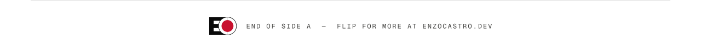

<a href="https://enzocastro.dev">
  <picture>
    <source media="(prefers-color-scheme: dark)" srcset="./assets/header-dark.svg">
    
  </picture>
</a>

 

I build products from the interface to the database — **mobile apps, web systems and APIs**.
Software engineer intern at **dti digital**, on international teams. Computer Science student at **PUC Minas**.

 

### `A1` &nbsp; Experience

**Software Engineer Intern** · dti digital &nbsp;`JAN 2026 — NOW`

- **Mobile app for a large international resort** — React Native app with a NestJS backend, built with an international team.
- **Backend for an international client** — a BFF in C#/.NET on AWS Lambda and API Gateway, integrating many services.

<!-- Client name: write it only if dti allows. -->

 

### `A2` &nbsp; Selected work

<!-- Replace these rows with your new projects when they are ready. -->

| | Project | Notes | Stack |
|:-:|---|---|---|
| `01` | **[ingressos-distribuido](https://github.com/oEnzoCastro/ingressos-distribuido)** | Distributed ticket sales. No seat is sold twice, and the system keeps working when a node fails. | `Python` `gRPC` `Docker` |
| `02` | **Invictus** · [demo ↗](https://youtu.be/GqrRLPaW_Dw) | All-in-one health app: workouts, diets, a marketplace for professionals, gamification. Team of 5. | `Flutter` `Firebase` |
| `03` | **AutoBraille** | Low-cost Braille cell for blind users, connected to the NVDA screen reader. I built the firmware and the serial bridge. | `Arduino` `Python` |
| `04` | **[AEDS3](https://github.com/oEnzoCastro/AEDS3)** | Disk-based database engine: B-Tree, dynamic hashing, Huffman/LZW, KMP, RSA. | `Java` |

 

### `A3` &nbsp; Liner notes

| Area | Tools |
|---|---|
| **Mobile** | `React Native` `Flutter` |
| **Web** | `TypeScript` `React` `Next.js` |
| **Backend** | `C#` `.NET` `Node.js` `NestJS` `Python` `Java` |
| **Cloud & data** | `AWS Lambda` `API Gateway` `PostgreSQL` `Docker` |

 

### `A4` &nbsp; Contact

[enzocastro.dev](https://enzocastro.dev) &nbsp;·&nbsp; [LinkedIn](https://www.linkedin.com/in/oenzocastro) &nbsp;·&nbsp; [Email](mailto:enzocastru@gmail.com)

 

<picture>
  <source media="(prefers-color-scheme: dark)" srcset="./assets/footer-dark.svg">
  
</picture>
